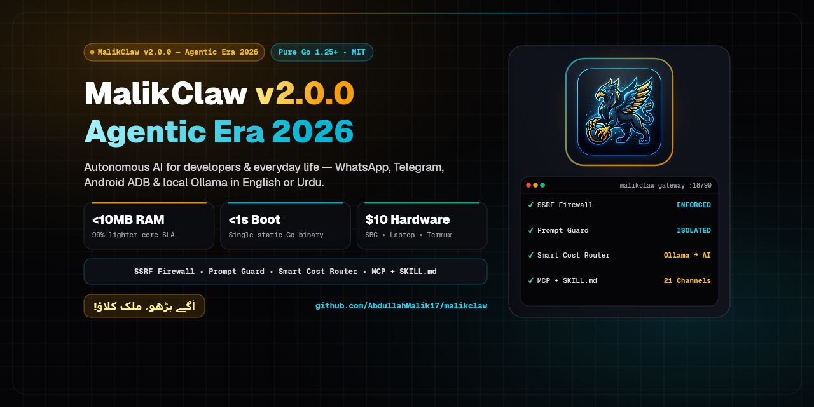
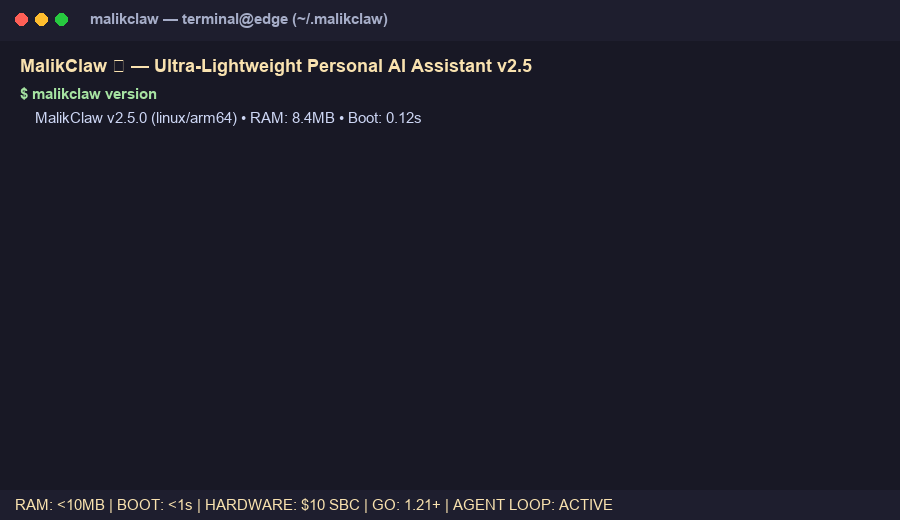
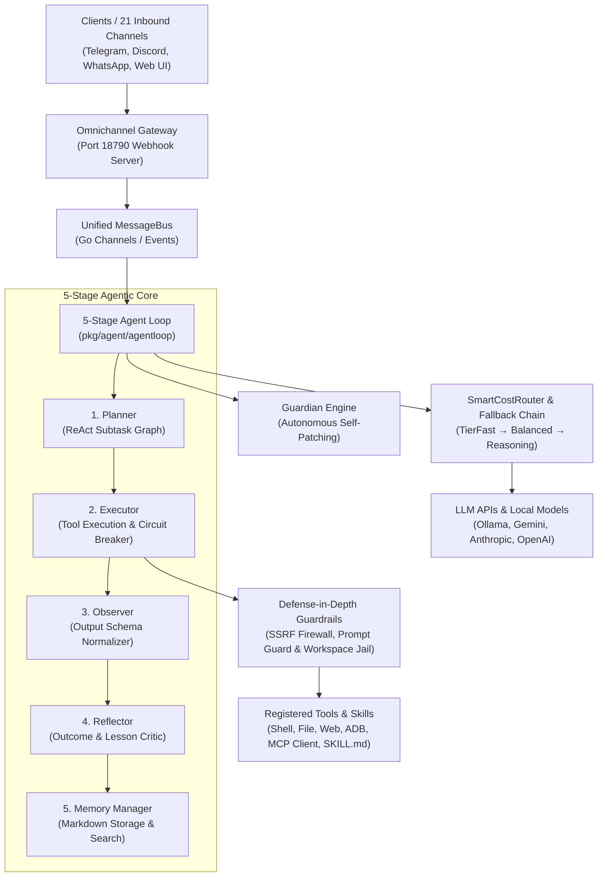
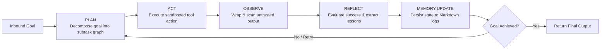

<div align="center">
  <a href="https://malikclaw.vercel.app">
    
  </a>
  <h1>MalikClaw 🦅 <a href="https://malikclaw.vercel.app"><code>v2.0.0</code></a></h1>
  <h3>Agentic Era 2026 — Everyday Edge AI &amp; Production Agent Runtime in Pure Go</h3>
  <p><strong>Sub-Second Boot (<code>&lt;1s</code>) • Ultra-Low Footprint (<code>&lt;10MB</code> core SLA) • $10 Hardware • English &amp; اردو (RTL) • 100% Private &amp; Self-Hostable</strong></p>
  <p>
    <a href="https://github.com/AbdullahMalik17/malikclaw/actions/workflows/build.yml"></a>
    
    <a href="https://pkg.go.dev/github.com/AbdullahMalik17/malikclaw"></a>
    <a href="https://snyk.io/test/github/AbdullahMalik17/malikclaw"></a>
    <a href="https://malikclaw.vercel.app"></a>
    
    <a href="https://github.com/AbdullahMalik17/malikclaw/blob/main/LICENSE"></a>
    <a href="https://github.com/AbdullahMalik17/malikclaw/stargazers"></a>
    <a href="https://mcpmarket.com/server/malikclaw?utm_source=readme&amp;utm_medium=badge"></a>
  </p>
  <p>
    <a href="https://malikclaw.vercel.app"><strong>Website</strong></a> •
    <a href="QUICKSTART.md"><strong>Quickstart Guide</strong></a> •
    <a href="INSTALLATION.md"><strong>Installation</strong></a> •
    <a href="ARCHITECTURE.md"><strong>Architecture</strong></a> •
    <a href="docs/benchmark/results.md"><strong>Benchmarks</strong></a> •
    <a href="FAQ.md"><strong>FAQ</strong></a> •
    <a href="CHANGELOG.md"><strong>Changelog</strong></a> •
    <a href="SECURITY.md"><strong>Security</strong></a> •
    <a href="CONTRIBUTING.md"><strong>Contributing</strong></a> •
    <a href="ROADMAP.md"><strong>Roadmap</strong></a>
  </p>
  <p>
    <a href="README.ur.md">اردو</a> | <a href="README.ja.md">日本語</a> | <a href="README.pt-br.md">Português</a> | <a href="README.vi.md">Tiếng Việt</a> | <a href="README.fr.md">Français</a> | <strong>English</strong>
  </p>
</div>

---

## ⚡ Dual-Audience Quick Start (`v2.0.0` — Zero Friction)

Whether you want an everyday personal assistant with **zero coding** or a hardened **Go `1.25+` agent runtime** with SSRF &amp; prompt-injection defense, start in 30 seconds:

<table>
<tr>
<td width="50%" valign="top">
<h3>🌟 For Everyday Users (Zero Coding)</h3>
<p>Turn any laptop, <code>$10</code> SBC, or old Android phone into your private assistant in <strong>English or Urdu (RTL)</strong>:</p>
<ol>
  <li><strong>Install in 1 line:</strong>
    <ul>
      <li><strong>Linux / macOS / Termux:</strong> <code>curl -fsSL https://raw.githubusercontent.com/AbdullahMalik17/malikclaw/main/install.sh | bash</code></li>
      <li><strong>Windows (PowerShell):</strong> <code>irm https://raw.githubusercontent.com/AbdullahMalik17/malikclaw/main/install.ps1 | iex</code></li>
      <li><strong>Node.js (all platforms):</strong> <code>npm install -g malikclaw</code></li>
    </ul>
  </li>
  <li><strong>Run guided setup:</strong> <code>malikclaw onboard</code></li>
  <li><strong>Automate daily life:</strong>
    <ul>
      <li>💬 <strong>WhatsApp &amp; Telegram Assistant:</strong> Morning briefings, message summaries &amp; Urdu/English reminders</li>
      <li>📱 <strong>Android ADB Phone Automation:</strong> Take screenshots, open apps, tap &amp; reply hands-free</li>
      <li>🌐 <strong>Clean Web UI:</strong> Open <code>http://localhost:18790</code> — no terminal required after setup</li>
    </ul>
  </li>
</ol>
</td>
<td width="50%" valign="top">
<h3>🛠️ For Developers &amp; Self-Hosters</h3>
<p>Single static <strong>Go <code>1.25+</code></strong> binary (<code>~12–15 MB</code> stripped), engineered for defense-in-depth and edge efficiency:</p>
<ul>
  <li>🛡️ <strong>SSRF Network Firewall (<code>pkg/security/ssrf.go</code>):</strong> Blocks RFC1918, CGNAT, link-local, metadata &amp; IPv4-mapped IPv6 bypasses on web/MCP calls</li>
  <li>🔒 <strong>Prompt-Injection Structural Guard (<code>pkg/security/prompt_guard.go</code>):</strong> Isolates untrusted tool outputs in escaped <code>&lt;untrusted_data&gt;</code> envelopes + 4-category scanning</li>
  <li>⚡ <strong>SmartCostRouter (<code>pkg/routing/cost_router.go</code>):</strong> Routes simple tasks to local <strong>Ollama</strong> / mini models and complex tasks to frontier models with <code>429</code>/<code>5xx</code> fallback</li>
  <li>🔌 <strong>Universal <code>SKILL.md</code> + MCP Client (<code>21</code> channels):</strong> Dynamic <code>stdio</code>/<code>sse</code>/<code>http</code> MCP client (<code>pkg/mcp/manager.go</code>) + progressive skill loading (<code>pkg/skills/loader.go</code>)</li>
</ul>
</td>
</tr>
</table>

### One-Command Install, Node.js &amp; Non-Root Docker

**Linux / macOS / Termux:**
```bash
curl -fsSL https://raw.githubusercontent.com/AbdullahMalik17/malikclaw/main/install.sh | bash
```

**Windows (PowerShell):**
```powershell
irm https://raw.githubusercontent.com/AbdullahMalik17/malikclaw/main/install.ps1 | iex
```

**Node.js (any platform with Node 18+):**
```bash
npm install -g malikclaw
```
The npm package is a thin launcher that auto-installs the `@malikclaw/cli-<os>-<cpu>` package containing the native Go binary for your platform. Published alongside every GitHub release.

**Docker (Non-Root `alpine:3.23` Runtime):**
```bash
docker run -d --name malikclaw -p 18790:18790 -v ~/.malikclaw:/home/malikclaw/.malikclaw ghcr.io/abdullahmalik17/malikclaw:latest
```

**Configure &amp; Launch:**
```bash
# Run interactive onboarding setup (English / Urdu)
malikclaw onboard

# Execute a direct CLI prompt
malikclaw agent -m "Summarize the system specs of this machine and save it to specs.md"

# Start the web UI and omnichannel gateway (Dashboard on http://localhost:18790)
malikclaw gateway
```

---

## 🎬 Live Terminal Demo

<div align="center">
  
  <p><sub><em>Real-time demonstration of MalikClaw agent loop initializing in &lt;0.8s, executing ReAct subtask planning, sandboxed tool execution, and updating Markdown memory on &lt;10MB core RAM SLA.</em></sub></p>
</div>

---

## ⚡ 30-Second Overview

### What is MalikClaw?
**MalikClaw `v2.0.0` (*"Agentic Era 2026"*)** is a production-grade, zero-dependency personal AI agent engine engineered in pure **Go `1.25+`**. Designed for extreme resource efficiency and real-world security, it brings autonomous AI capabilities—tool execution, multi-step planning, persistent Markdown memory, smart model cost routing, and **21 messaging/social channels**—to low-power single-board computers (SBCs), Android phones, local edge nodes, and cloud containers.

### Why Use MalikClaw?
- 🪶 **`&lt;10MB` Core RAM SLA &amp; `&lt;0.8s` Boot**: Up to 99% lighter than heavy Python/Node agent frameworks (`~14.2 MB` measured x86_64 idle RSS in [full benchmarks](docs/benchmark/results.md)).
- 💰 **Runs on $10 Hardware**: Deploys seamlessly on Orange Pi Zero, Raspberry Pi Zero 2 W, recycled Android smartphones (via Termux), and low-tier VPS instances.
- 💬 **21 Messaging &amp; Social Channels**: Unified Go `MessageBus` for Telegram, Discord, WhatsApp (`whatsapp` &amp; `whatsapp_native`), Matrix, Slack, Google Chat, IRC, TikTok, LinkedIn, Twitter/X, Reddit, Instagram, WeCom, QQ, DingTalk, LINE, Feishu, OneBot, Pico, and MaixCam.
- 📱 **Native Mobile ADB &amp; Termux Control**: Autonomous phone automation—take screenshots, tap UI elements, swipe, type, and launch apps.
- 🛡️ **Defense-in-Depth Security (`v2.0.0`)**: SSRF Network Boundary Firewall (`ValidateURL` / `IsBlockedIP`), Prompt-Injection Structural Guard (`WrapUntrusted` / `ScanPromptInjection`), workspace jailing (`restrict_to_workspace`), and shell command filtering.
- 💸 **Smart Multi-Model Cost Router**: `SmartCostRouter` routes simple everyday tasks to fast/local models (Ollama, `gemini-2.5-flash`, `gpt-4o-mini`) and complex reasoning to frontier models with automatic fallback.
- 🧩 **Universal `SKILL.md` + MCP Client**: Progressive `SKILL.md` ecosystem (`pkg/skills/loader.go`) and **MCP Client / Host** (`pkg/mcp/manager.go`) supporting `stdio`, `sse`, and `http` transports.
- 🤖 **Guardian Engine**: Autonomous code auditing, debugging, and self-patching capabilities.

---

## 💻 Embed MalikClaw in Go (Production Snippet)

MalikClaw can be embedded directly into your Go microservices as a lightweight agent runtime:

```go
package main

import (
	"context"
	"fmt"
	"log"
	"time"

	"github.com/AbdullahMalik17/malikclaw/pkg/agent/agentloop"
	"github.com/AbdullahMalik17/malikclaw/pkg/providers"
	"github.com/AbdullahMalik17/malikclaw/pkg/tools"
)

func main() {
	ctx, cancel := context.WithTimeout(context.Background(), 3*time.Minute)
	defer cancel()

	workspace := "/home/user/workspace"

	// 1. Initialize LLM Provider (OpenAI-compatible endpoint, Ollama, Gemini, etc.)
	provider := providers.NewHTTPProvider(
		"sk-proj-your-api-key",
		"https://api.openai.com/v1",
		"",
	)

	// 2. Initialize Tool Registry and register workspace-restricted tools
	toolRegistry := tools.NewToolRegistry()
	toolRegistry.Register(tools.NewReadFileTool(workspace, true, 0))
	toolRegistry.Register(tools.NewWriteFileTool(workspace, true))
	toolRegistry.Register(tools.NewListDirTool(workspace, true))

	// 3. Configure the 5-Stage Agentic Loop
	cfg := agentloop.DefaultLoopConfig(workspace)
	cfg.MaxIterations = 10
	cfg.EnableReflection = true
	cfg.Reflector.Model = "gpt-4o-mini"

	// 4. Instantiate & Run Agent Loop
	loop := agentloop.NewAgentLoop(cfg, toolRegistry, provider)
	defer loop.Close()

	result, err := loop.ExecuteGoal(ctx, "Research recent Go 1.25 features and write a summary in go_features.md")
	if err != nil {
		log.Fatalf("Agent execution failed: %v", err)
	}

	fmt.Printf("Goal Achieved: %t | Actions Taken: %d | Duration: %s\n",
		result.Success, result.ActionsTaken, result.Duration)
}
```

---

## 📊 Performance Benchmarks (MalikClaw `v2.0.0` vs Alternatives)

Benchmarked across edge ARMv7 (`Orange Pi Zero`, 512MB RAM) for core SLA and x86_64 Linux (`Intel i7`, 16GB RAM) for full runtime profiling ([methodology &amp; results](docs/benchmark/results.md)):

| Metric | Python (AutoGen / CrewAI) | LangChain (Python) | OpenClaw (Node.js) | **MalikClaw `v2.0.0` (Go 1.25+)** |
| :--- | :--- | :--- | :--- | :--- |
| **Idle Memory (RAM)** | 180MB – 450MB | 210MB – 500MB | 350MB – 1.2GB | **`<10MB` core SLA** (`~14.2 MB` x86_64 RSS) |
| **Boot / Cold Start** | 12.4s – 35.0s | 15.1s – 42.0s | 8.5s – 18.0s | **`<0.8s`** (`<1s` SLA) |
| **Binary / Package Size** | 850MB (virtualenv + libs) | 920MB (pip packages) | 650MB (`node_modules`) | **`~12–15 MB`** stripped static binary |
| **Hardware Minimum** | 2GB RAM PC ($100+) | 2GB RAM PC ($100+) | 1GB RAM Pi ($35+) | **$10 Edge SBC / Laptop / Recycled Phone** |
| **Security &amp; Isolation** | Manual sandbox setup | Manual sandbox setup | Plugin scrutiny | **SSRF Firewall + Prompt Guard + Workspace Jail** |
| **Cost &amp; Model Routing** | Static / manual config | Static / manual config | Single static model | **SmartCostRouter (`Ollama` → Frontier fallback)** |
| **Ecosystem &amp; Channels** | Python SDK | Python SDK | Plugin marketplace | **21 Channels + MCP Client + Universal `SKILL.md`** |
| **100% Private Offline** | Complex setup | Complex setup | Partial | **Native Ollama, SearXNG &amp; Local Markdown** |

---

## 🏛️ High-Level System Architecture



---

## 🔄 The 5-Stage Agent Loop Architecture



---

## ✨ Core Features &amp; Capabilities

- 🧠 **5-Stage Production Agent Loop**: Complete cycle of planning, step execution, output observation, reflection, and persistent memory updates.
- 🛡️ **Defense-in-Depth Security (`v2.0.0`)**: SSRF Network Boundary Firewall (`pkg/security/ssrf.go`), Prompt-Injection Structural Guard (`pkg/security/prompt_guard.go`), workspace jailing (`restrict_to_workspace`), and shell regex command blocking.
- 💸 **Smart Multi-Model Cost Router (`pkg/routing/cost_router.go`)**: Complexity-aware tiering (`TierFast` local Ollama/`gemini-2.5-flash`/`gpt-4o-mini` → `TierBalanced` → `TierReasoning` frontier) with automatic `429`/`5xx` fallback.
- 🧩 **Universal `SKILL.md` Ecosystem (`pkg/skills/loader.go`)**: Progressive YAML/JSON frontmatter + Markdown AST loading compatible with `~/.agents/skills/` and `malikclaw skills install`.
- 🔌 **MCP (Model Context Protocol) Client / Host (`pkg/mcp/manager.go`)**: Connect external MCP servers over `stdio`, `sse`, and `http` transports to dynamically extend agent capabilities.
- 💬 **21-Channel Omnichannel Messaging Engine**: Native `MessageBus` integration for Telegram, Discord, WhatsApp (`whatsapp` &amp; `whatsapp_native`), Matrix, Google Chat, IRC, WeCom, QQ, DingTalk, LINE, Feishu, Slack, OneBot, Pico, MaixCam, TikTok, LinkedIn, Twitter/X, Instagram, and Reddit.
- 📱 **Mobile &amp; Android ADB Automation**: Direct mobile control over USB/Wi-Fi ADB or headless native execution inside Android Termux.
- 🌐 **Web Interface &amp; Dashboard**: Modern Bento Grid UI listening on `http://localhost:18790` with real-time logs, agent controls, and chat shortcuts.
- 🛠️ **Guardian Self-Evolution**: Autonomous code inspection and safe git-diff patching for self-healing software agents.
- 🌍 **RTL &amp; Multilingual Translation**: Built-in localization support for English, Urdu (RTL), Japanese, French, Portuguese, and Vietnamese.

---

## 🤖 Supported Model Providers & Web Search Engines

### LLM Providers
- **OpenAI**: `gpt-4o`, `gpt-4o-mini`, `o1`, `o3-mini`
- **Anthropic**: `claude-3-7-sonnet`, `claude-3-5-haiku` (Native & Messages API, Prompt Caching)
- **Google AI & Antigravity**: Gemini 2.5 Pro, Gemini 2.5 Flash, Cloud Code Assist integration
- **Ollama (Local Models)**: Llama 3.3, DeepSeek-R1, Qwen 2.5, Mistral (`http://localhost:11434/v1`)
- **Groq**: Ultra-fast LLaMA & Mixtral inference
- **DeepSeek**: DeepSeek-V3, DeepSeek-R1
- **Zhipu GLM**: GLM-4 Flash / Plus
- **OpenRouter & ModelScope**: Unified proxy access to hundreds of open/closed models

### Web Search Providers
- **DuckDuckGo**: Free zero-config default search engine
- **Tavily**: AI-optimized structured research API
- **Brave Search**: Fast, independent privacy-first web index
- **Perplexity**: Conversational AI search
- **SearXNG**: Self-hosted privacy meta-search engine

---

## 🖥️ Platform & Hardware Support

| OS / Runtime | Architecture Support | Tested Devices / Environments |
| :--- | :--- | :--- |
| **Linux** | `x86_64`, `arm64`, `armv7`, `riscv64` | Ubuntu, Debian, Alpine, Arch, Orange Pi, Raspberry Pi |
| **Android** | `arm64`, `armv7` | Termux non-root environment, Android 8.0+ |
| **macOS** | `arm64` (Apple Silicon), `x86_64` | macOS Monterey, Ventura, Sonoma, Sequoia |
| **Windows** | `x86_64`, `arm64` | Windows 10, Windows 11, WSL2 |
| **Containers** | Multi-arch Docker &amp; Kubernetes | Multi-stage `alpine:3.23` (non-root `malikclaw`), full MCP container |

---

## 📚 Documentation Index

- [**QUICKSTART.md**](QUICKSTART.md): 5-minute onboarding & initial command guide.
- [**INSTALLATION.md**](INSTALLATION.md): Detailed installation options (One-liner, Docker, Brew, Source).
- [**ARCHITECTURE.md**](ARCHITECTURE.md): Deep-dive into internal packages, subsystems, and Go API patterns.
- [**FAQ.md**](FAQ.md): Frequently asked questions on setup, performance, ADB, and security.
- [**CHANGELOG.md**](CHANGELOG.md): Version history, release notes, and migration steps.
- [**SECURITY.md**](SECURITY.md): Threat model, directory sandboxing, and security policies.
- [**CODE_OF_CONDUCT.md**](CODE_OF_CONDUCT.md): Community guidelines and standards.
- [**CONTRIBUTING.md**](CONTRIBUTING.md): Developer guide for submitting code, tools, and translations.
- [**ROADMAP.md**](ROADMAP.md): Future technical vision and community priorities.

---

## 📄 License & Attribution

MalikClaw is licensed under the **MIT License**. See [LICENSE](LICENSE) for details.

<div align="center">
  <p><strong>🦅 Built with ❤️ for developers worldwide</strong></p>
  <p><em>آگے بڑھو، ملک کلاؤ! (Let's Go, MalikClaw!)</em></p>
</div>
