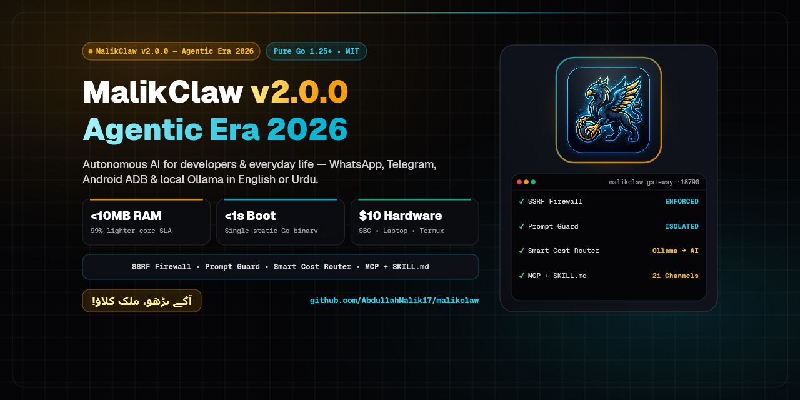
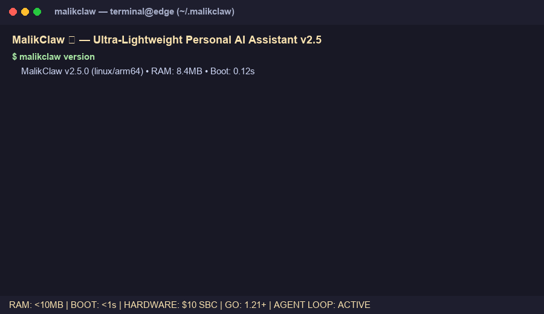
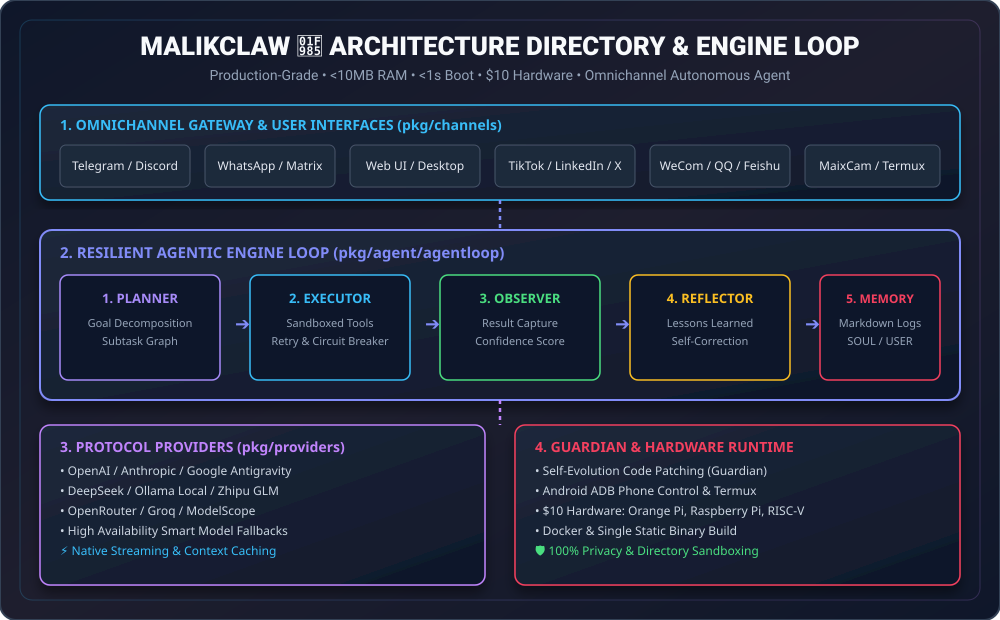

<div align="center">
  <a href="https://malikclaw.vercel.app">
    
  </a>

  <h1>MalikClaw 🦅 <a href="https://malikclaw.vercel.app"><code>v2.0.0</code></a></h1>

  <h3>ایجنٹک ایرا 2026 — روزمرہ زندگی اور ڈیولپرز کے لیے تیز ترین ذاتی AI ایجنٹ</h3>
  <p><strong>پروڈکشن گریڈ • &lt;10MB RAM (کور SLA) • &lt;1s بُوٹ • $10 ہارڈویئر • SSRF + Prompt Guard • Smart Cost Router</strong></p>

  <p>
    <a href="https://github.com/AbdullahMalik17/malikclaw/actions/workflows/build.yml"></a>
    
    <a href="https://pkg.go.dev/github.com/AbdullahMalik17/malikclaw"></a>
    <a href="https://snyk.io/test/github/AbdullahMalik17/malikclaw"></a>
    <a href="https://malikclaw.vercel.app"></a>
    
    <a href="https://github.com/AbdullahMalik17/malikclaw/blob/main/LICENSE"></a>
    <br />
    <a href="https://github.com/AbdullahMalik17/malikclaw/stargazers"></a>
    <a href="https://github.com/AbdullahMalik17/malikclaw/network/members"></a>
    <a href="https://github.com/AbdullahMalik17/malikclaw/issues"></a>
    <a href="https://mcpmarket.com/server/malikclaw?utm_source=readme&amp;utm_medium=badge"></a>
    <a href="https://www.npmjs.com/package/malikclaw"></a>
    <a href="https://www.npmjs.com/package/malikclaw"></a>
    <a href="https://inspect.software/software/AbdullahMalik17/malikclaw"></a>
    <a href="https://vettiq.ai/mcp/malikclaw/"></a>
  </p>

  

<p align="center">
  <a href="#-فوری-شروع">فوری شروع</a> •
  <a href="#-خصوصیات">خصوصیات</a> •
  <a href="#-سسٹم-آرکیٹیکچر">آرکیٹیکچر</a> •
  <a href="#-انسٹالیشن">انسٹالیشن</a> •
  <a href="#-ڈیمو">ڈیمو</a> •
  <a href="#-دستاویزات">دستاویزات</a> •
  <a href="#-کمیونٹی">کمیونٹی</a>
</p>

**اردو** | [日本語](README.ja.md) | [Português](README.pt-br.md) | [Tiếng Việt](README.vi.md) | [Français](README.fr.md) | [English](README.md)

</div>

---

## 🚀 فوری شروع

### ایک کمانڈ انسٹالیشن

**Linux/macOS:**
```bash
curl -fsSL https://raw.githubusercontent.com/AbdullahMalik17/malikclaw/main/install.sh | bash
```

**Windows (PowerShell):**
```powershell
irm https://raw.githubusercontent.com/AbdullahMalik17/malikclaw/main/install.ps1 | iex
```

**Docker:**
```bash
docker run -d --name malikclaw -p 18790:18790 -v ~/.malikclaw:/home/malikclaw/.malikclaw ghcr.io/abdullahmalik17/malikclaw:latest
```

### سیٹ اپ (5 منٹ)

1. **آن بورڈنگ چلائیں:** `malikclaw onboard`
2. **API کیز شامل کریں:** `~/.malikclaw/config.json` میں ایڈٹ کریں (یا SmartCostRouter کے لیے مقامی Ollama استعمال کریں)
3. **ٹیسٹ کریں:** `malikclaw agent -m "Hello!"`

📖 **مکمل گائیڈ:** [PRODUCT.md](PRODUCT.md) | [QUICKSTART.md](QUICKSTART.md) | [INSTALLATION.md](docs/INSTALLATION.md)

---

## ✨ خصوصیات

### 🤖 پروڈکشن گریڈ ایجنٹ لوپ

**نیا:** مکمل ایگزیکوشن سائیکل کے ساتھ جدید ایجنٹک آرکیٹیکچر:

```
PLAN ➔ ACT ➔ OBSERVE ➔ REFLECT ➔ MEMORY UPDATE
```

- **انٹیلیجنٹ پلاننگ:** مقاصد کو عملی مراحل میں تقسیم کرنا
- **لچکدار عمل درآمد:** ایکسپونینشل بیک آف اور سرکٹ بریکر کے ساتھ retry لاجک
- **سمارٹ مشاہدہ:** نتیجہ کیپچر، نارملائزیشن، اور اعتماد اسکورنگ
- **گہری عکاسی:** کامیابی/ناکامی کی تشخیص کے ساتھ سبق سیکھا
- **مستقل میموری:** تلاش اور تجزیہ کے ساتھ ایپی سوڈ اسٹوریج

📖 **تکنیکی دستاویزات:** [pkg/agent/agentloop/README.md](pkg/agent/agentloop/README.md)

### 💬 اومنی چینل میسجنگ اور سوشل میڈیا انٹیگریشن

- **21 میسجنگ اور سوشل پلیٹ فارمز:** Telegram, Discord, WhatsApp (`whatsapp` اور `whatsapp_native`), Matrix, Slack, Google Chat, IRC, TikTok, LinkedIn, Twitter (X), Reddit, Instagram, WeCom, QQ, DingTalk, LINE, Feishu, OneBot, Pico, MaixCam
- **زیرو فٹ پرنٹ گیٹ وے:** پورٹ 18790 پر واحد HTTP سرور

### 🌍 کثیر لسانی سپورٹ

- **مقامی انٹرفیس:** اردو، انگریزی، جاپانی، فرانسیسی، پرتگالی، ویتنامی
- **RTL سپورٹ:** اردو/عربی صارفین کے لیے مقامی دائیں سے بائیں سپورٹ
- **عالمی رسائی:** دنیا بھر کے ڈیولپرز اور روزمرہ صارفین کے لیے اوپن سورس (MIT)

### 🪶 انتہائی ہلکا پھلکا

- **<10MB RAM** — عام AI ایجنٹس سے 99% چھوٹا
- **<0.8s بُوٹ (<1s SLA)** — Python/Node.js ایجنٹس (8.5s–42.0s) کے مقابلے میں فوری شروعات
- **$10 ہارڈویئر** — Orange Pi Zero، Raspberry Pi Zero، RISC-V، پرانے Android فونز پر چلتا ہے
- **کراس پلیٹ فارم** — Linux, macOS, Windows, Docker

### 📱 موبائل آپریشن

- **ADB کنٹرول:** Android ڈیوائسز پر اسکرین شاٹ، ٹیپ، سوائپ، ٹائپ کریں
- **Termux سپورٹ:** Android پر براہ راست root کے بغیر چلائیں
- **دوسری زندگی:** اپنے پرانے فون کو AI اسسٹنٹ کے طور پر مقصد دیں

### 🛠️ خود سے ارتقاء

- **گارڈین انجن:** خود مختار کوڈ بہتری
- **اسکل سسٹم:** پلگ انز کے ذریعے توسیع پذیر
- **ویب سرچ:** DuckDuckGo، Tavily، Brave، Perplexity، SearXNG

---

## 🏛️ سسٹم آرکیٹیکچر

<div align="center">
  
</div>

📖 **تفصیلی آرکیٹیکچر گائیڈ:** [ARCHITECTURE.md](docs/ARCHITECTURE.md)

---

## 📊 کارکردگی کا موازنہ

| پیمانہ | OpenClaw | Python ایجنٹس (AutoGen / CrewAI) | **MalikClaw `v2.0.0` (Go 1.25+)** |
|--------|----------|----------------------------------|-----------------------------------|
| **زبان** | TypeScript (Node.js) | Python | **Pure Go 1.25+** |
| **RAM استعمال** | `350MB – 1.2GB` | `180MB – 450MB` | **`<10MB` کور SLA** (`~14.2 MB` x86_64 RSS) |
| **بُوٹ کا وقت** | `8.5s – 18.0s` | `12.4s – 35.0s` | **`<0.8s`** (`<1s` SLA) |
| **کم از کم ہارڈویئر** | 1GB RAM Pi ($35+) | 2GB RAM PC ($100+) | **$10 ایج SBC / لیپ ٹاپ / پرانا فون** |
| **سیکیورٹی و رازداری** | پلگ ان جانچ | دستی سینڈ باکس | **SSRF فائر وال + Prompt Guard + 100% لوکل** |

📖 **مکمل بینچ مارک طریقہ کار اور نتائج:** [docs/benchmark/results.md](docs/benchmark/results.md)

---

## 📦 انسٹالیشن

### سسٹم کی ضروریات

| پلیٹ فارم | کم از کم | تجویز کردہ |
|----------|---------|-------------|
| **Linux SBC** | Orange Pi Zero ($10) | Raspberry Pi 4 |
| **Android** | 2GB RAM، Termux | 4GB RAM |
| **ڈیسک ٹاپ** | 2GB RAM، کوئی بھی OS | 4GB RAM |
| **Docker** | 512MB RAM | 1GB RAM |

### انسٹالیشن کے طریقے

#### 1. ایک کمانڈ انسٹال (تجویز کردہ)

اوپر [فوری شروع](#-فوری-شروع) دیکھیں۔

#### 2. سورس سے بنائیں

```bash
git clone https://github.com/AbdullahMalik17/malikclaw.git
cd malikclaw

# موجودہ پلیٹ فارم کے لیے بنائیں
make build

# بنائیں اور انسٹال کریں
make install

# کئی پلیٹ فارمز کے لیے بنائیں
make build-all
```

#### 3. Docker

```bash
# کم از کم (Alpine-based)
docker compose -f docker/docker-compose.yml --profile gateway up

# مکمل خصوصیت (Node.js 24 MCP سپورٹ کے لیے)
docker compose -f docker/docker-compose.full.yml --profile gateway up
```

#### 4. پیکج مینیجرز

**Homebrew (macOS):**
```bash
brew install malikclaw
```

**Scoop (Windows):**
```bash
scoop install malikclaw
```

**AUR (Arch Linux):**
```bash
yay -S malikclaw
```

---

## 🎮 ڈیمو

### انٹرایکٹو ڈیمو اسکرپٹ

تمام صلاحیتوں کا مظاہرہ کرنے والی جامع ڈیمو چلائیں:

```bash
curl -fsSL https://raw.githubusercontent.com/AbdullahMalik17/malikclaw/main/demo.sh | bash
```

### ڈیمو 1: فون کنٹرول (ADB)

**ضروریات:**
- USB ڈی بگنگ فعال کے ساتھ Android ڈیوائس
- ADB انسٹال (`sudo apt install android-tools-adb`)

**کمانڈز:**
```bash
# اسکرین شاٹ لیں
malikclaw agent -m "Take a screenshot of my phone"

# کوآرڈینیٹس پر ٹیپ کریں
malikclaw agent -m "Tap at position 500, 1000 on my phone"

# ٹیکسٹ ٹائپ کریں
malikclaw agent -m "Type 'Hello World' on my phone"

# ایپ کھولیں
malikclaw agent -m "Open WhatsApp on my phone"

# سوائپ حرکت
malikclaw agent -m "Swipe up on my phone screen"
```

### ڈیمو 2: ای میل (Gmail)

**ضروریات:**
- Gmail اکاؤنٹ
- config میں Gmail API فعال

**کمانڈز:**
```bash
# ای میل بھیجیں
malikclaw agent -m "Send an email to john@example.com with subject 'Meeting' and body 'Let's meet at 3pm tomorrow'"

# حالیہ ای میلز دیکھیں
malikclaw agent -m "Show my 5 most recent emails"

# ای میلز تلاش کریں
malikclaw agent -m "Find emails from last week about 'project'"

# ای میل کا جواب دیں
malikclaw agent -m "Reply to the last email with 'Thanks, I'll review it'"
```

### ڈیمو 3: ویب سرچ

**ضروریات:**
- انٹرنیٹ کنکشن
- DuckDuckGo ڈیفالٹ کے طور پر فعال (کوئی API key نہیں چاہیے)

**کمانڈز:**
```bash
# موجودہ موسم حاصل کریں
malikclaw agent -m "What's the weather in Lahore today?"

# خبریں تلاش کریں
malikclaw agent -m "What are the latest AI news today?"

# موضوع پر تحقیق کریں
malikclaw agent -m "Research quantum computing breakthroughs in 2025"

# دستاویزات حاصل کریں
malikclaw agent -m "Fetch the Go 1.25 release notes"

# ٹیوٹوریلز تلاش کریں
malikclaw agent -m "Find Go programming tutorials for beginners"
```

---

## 🖥️ ویب انٹرفیس

جدید ویب UI تک رسائی: **http://localhost:18790**

**خصوصیات:**
- حقیقی وقت چیٹ انٹرفیس
- اسٹیٹس ڈیش بورڈ (ایجنٹ اسٹیٹس، میموری استعمال، ٹولز، اپ ٹائم)
- ڈیمو ٹاسک شارٹ کٹس
- رسپانسو ڈیزائن (موبائل فرینڈلی)
- ڈارک تھیم

**ویب UI شروع کریں:**
```bash
malikclaw gateway
```

یا Docker کے ساتھ:
```bash
docker run -d -p 18790:18790 -v ~/.malikclaw:/home/malikclaw/.malikclaw ghcr.io/abdullahmalik17/malikclaw:latest
```

---

## ⚙️ کنفیگریشن

### بنیادی کنفگ

سیٹ اپ کے لیے `malikclaw onboard` چلائیں یا `~/.malikclaw/config.json` ایڈٹ کریں (موجودہ کنفگ دیکھنے کے لیے `malikclaw config show` استعمال کریں):

```json
{
  "agents": {
    "defaults": {
      "model_name": "gpt-4o-mini",
      "restrict_to_workspace": true,
      "max_tokens": 8192,
      "routing": {
        "enabled": true,
        "mode": "smart",
        "fast_model": "gpt-4o-mini"
      }
    }
  },
  "model_list": [
    {
      "model_name": "gpt-4o-mini",
      "model": "openai/gpt-4o-mini",
      "api_key": "sk-your-api-key-here"
    }
  ],
  "tools": {
    "web": {
      "duckduckgo": { "enabled": true },
      "tavily": { "enabled": false }
    },
    "exec": { "enabled": true, "enable_deny_patterns": true },
    "read_file": { "enabled": true },
    "write_file": { "enabled": true }
  }
}
```

### API کیز حاصل کریں

**LLM پرووائیڈرز:**
- [OpenRouter](https://openrouter.ai/keys) - ملٹی پرووائیڈر ایکسیس
- [Zhipu](https://open.bigmodel.cn/) - چینی LLM پرووائیڈر
- [Anthropic](https://console.anthropic.com) - Claude ماڈلز
- [OpenAI](https://platform.openai.com) - GPT ماڈلز

**ویب سرچ (اختیاری):**
- [Tavily](https://tavily.com) - AI-آپٹیمائزڈ (1000 مفت سوالات/مہینہ)
- [Brave](https://brave.com/search/api) - ادا شدہ ($5/1000 سوالات)
- [Perplexity](https://www.perplexity.ai) - AI-پاورڈ
- [SearXNG](https://github.com/searxng/searxng) - خود میزبان، مفت

---

## 🎯 استعمال کی مثالیں

### 1. ذاتی اسسٹنٹ
- ای میلز اور کیلنڈر مینیج کریں
- یاد دہانیاں اور الارم سیٹ کریں
- معلومات کے لیے تلاش کریں
- سمارٹ ہوم ڈیوائسز کنٹرول کریں

### 2. ڈیولپر ٹول
- کوڈ جنریشن اور جائزہ
- فائل آپریشنز اور تلاش
- Git آپریشنز
- دستاویزات تلاش
- TODO کمنٹس ٹریکنگ

### 3. موبائل آٹومیشن
- بار بار فون کے کاموں کو خودکار کریں
- اسکرین شاٹس لیں اور ٹیکسٹ نکالیں
- WhatsApp کے ذریعے پیغامات بھیجیں
- ایپس کو ریموٹلی کنٹرول کریں

### 4. ایج AI
- کم پاور ہارڈویئر پر چلائیں
- لوکل ماڈلز کے ساتھ آف لائن قابل
- پرائیویسی فرسٹ (ڈیٹا لوکل رہتا ہے)
- کم سے کم پاور کے ساتھ 24/7 آپریشن

---

## 📚 دستاویزات

| دستاویز | تفصیل | سامعین |
|----------|-------------|----------|
| [PRODUCT.md](PRODUCT.md) | **فوری شروع گائیڈ** (5 منٹ سیٹ اپ) | نئے صارفین |
| [QUICKSTART.md](QUICKSTART.md) | فوری شروع گائیڈ | تمام صارفین |
| [README.product.md](README.product.md) | پروڈکٹ کا جائزہ | عمومی |
| [pkg/agent/agentloop/README.md](pkg/agent/agentloop/README.md) | ایجنٹ لوپ آرکیٹیکچر | ڈیولپرز |
| [CONTRIBUTING.md](CONTRIBUTING.md) | شراکت کے رہنما خطوط | شراکت دار |
| [ROADMAP.md](ROADMAP.md) | ترقیاتی روڈ میپ | کمیونٹی |

---

## 🔧 ٹربل شوٹنگ

### عام مسائل

**انسٹالیشن کے بعد "Command not found":**
```bash
export PATH="$HOME/.local/bin:$PATH"
echo 'export PATH="$HOME/.local/bin:$PATH"' >> ~/.bashrc
source ~/.bashrc
```

**"API key not configured":**
1. config فائل کا راستہ دیکھیں (`malikclaw config path`) اور `~/.malikclaw/config.json` کھولیں (یا موجودہ کنفگ دیکھنے کے لیے `malikclaw config show` چلائیں)
2. `model_list` میں اپنی API key شامل کریں
3. محفوظ کریں اور دوبارہ کوشش کریں

**"ADB device not found":**
```bash
# فون پر USB ڈی بگنگ فعال ہے چیک کریں
# منسلک ڈیوائسز کی فہرست
adb devices

# اگر خالی ہے، تو کوشش کریں:
adb kill-server
adb start-server
adb devices
```

**کم RAM والی ڈیوائسز پر "Out of memory":**
`~/.malikclaw/config.json` میں `agents.defaults` اور `tools.read_file` کی حدود کم کریں (تصدیق کے لیے `malikclaw config show` چلائیں یا `malikclaw onboard` سے دوبارہ سیٹ اپ کریں):
```json
{
  "agents": {
    "defaults": {
      "max_tokens": 4096,
      "max_tool_iterations": 10,
      "summarize_message_threshold": 15,
      "summarize_token_percent": 60,
      "routing": {
        "enabled": true,
        "mode": "smart",
        "fast_model": "gpt-4o-mini"
      }
    }
  },
  "tools": {
    "read_file": {
      "enabled": true,
      "max_read_file_size": 131072
    }
  }
}
```

📖 **مزید مدد:** [PRODUCT.md#-troubleshooting](PRODUCT.md#-troubleshooting)

---

## 🤝 شراکت

ہم شراکت کا خیرمقدم کرتے ہیں! رہنما خطوط کے لیے [CONTRIBUTING.md](CONTRIBUTING.md) دیکھیں۔

### شراکت کے طریقے
- 🐛 بگز رپورٹ کریں
- ✨ خصوصیات شامل کریں
- 📝 دستاویزات بہتر بنائیں
- 🌍 اپنی زبان میں ترجمہ کریں
- 💡 استعمال کی مثالیں شیئر کریں
- 🔌 اسکلز/پلگ انز بنائیں

### ڈیولپمنٹ سیٹ اپ

```bash
git clone https://github.com/AbdullahMalik17/malikclaw.git
cd malikclaw

# ڈیپنڈنسیز ڈاؤن لوڈ کریں
make deps

# ٹیسٹس چلائیں
make test

# بنائیں
make build

# لنٹرز چلائیں
make lint
```

---

## 📢 کمیونٹی

دنیا بھر کے ڈیولپرز اور صارفین کی ہماری عالمی کمیونٹی میں شامل ہوں:

- **GitHub:** [بحثیں](https://github.com/AbdullahMalik17/malikclaw/discussions)
- **ویب سائٹ:** [malikclaw.vercel.app](https://malikclaw.vercel.app)
- **Twitter:** [@AbdullahMalik17](https://twitter.com/AbdullahMalik17)
- **Discord:** [سرور میں شامل ہوں](https://discord.gg/malikclaw) (جلد ہی)

---

## 📄 لائسنس

MIT License — تفصیلات کے لیے [LICENSE](LICENSE) فائل دیکھیں۔

---

## 🌍 دنیا کے لیے بنایا گیا

MalikClaw کو دنیا بھر کے ڈیولپرز اور روزمرہ صارفین کے لیے بنایا گیا ہے — کثیر لسانی سپورٹ (**اردو RTL، انگریزی، جاپانی، فرانسیسی، پرتگالی، ویتنامی**) اور ہر قسم کے ہارڈویئر (`$10` SBC، لیپ ٹاپ، Android Termux، اور Docker) کے ساتھ!

**100% اوپن سورس — MIT لائسنس!**

---

<div align="center">

**🦅 دنیا کے لیے ❤️ کے ساتھ بنایا گیا**

**ہر جگہ، ہر وقت — ہر کسی کو کارآمد AI کے ساتھ بااختیار بنانا!**

</div>

---

## 📢 حالیہ اپ ڈیٹس

### مارچ 2026 - پروڈکشن گریڈ ایجنٹ لوپ

**نیا:** مکمل ایجنٹ لوپ عمل درآمد کے ساتھ:
- **Planner:** LLM اور ہیورسٹک پلاننگ کے ساتھ مقصد کی تقسیم
- **Executor:** retry، backoff، اور سرکٹ بریکر کے ساتھ ٹول ایگزیکوشن
- **Observer:** نتیجہ کیپچر، نارملائزیشن، اور اعتماد اسکورنگ
- **Reflector:** سبق سیکھا کے ساتھ کامیابی کی تشخیص
- **Memory:** تلاش کی صلاحیتوں کے ساتھ مستقل ایپی سوڈ اسٹوریج

**شامل فائلیں:**
- `pkg/agent/agentloop/` - مین آرکیسٹریٹر اور کنفیگریشن
- `pkg/agent/planner/planner.go` - بہتر پلاننگ سسٹم
- `pkg/agent/executor/executor.go` - لچکدار ایگزیکوشن انجن
- `pkg/agent/observer/observer.go` - مشاہدہ کیپچر
- `pkg/agent/reflector/reflector.go` - عکاسی انجن
- `pkg/agent/memory/memory.go` - میموری مینجمنٹ

**پروڈکٹ میں بہتری:**
- Linux/macOS اور Windows کے لیے ایک کمانڈ انسٹالرز
- فون، ای میل، اور سرچ کی صلاحیتوں کا مظاہرہ کرنے والا انٹرایکٹو ڈیمو اسکرپٹ
- چیٹ انٹرفیس اور اسٹیٹس ڈیش بورڈ کے ساتھ جدید ویب UI
- جامع دستاویزات (PRODUCT.md، QUICKSTART.md)

---

<div align="center">

**🦅 جنوبی ایشیائی ڈیولپرز کے لیے ❤️ کے ساتھ بنایا گیا**

**آگے بڑھو، ملک کلاؤ!**

</div>
